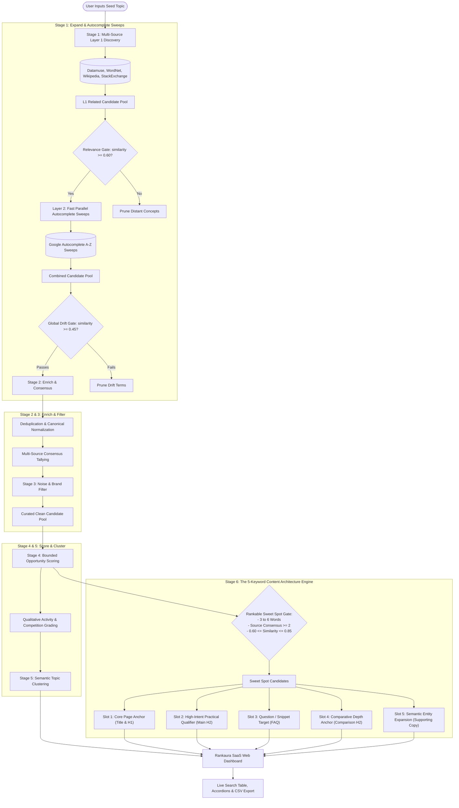

# Rankaura — Free SEO Keyword Discovery & Content Architecture Engine

> **Open discovery engine based on public search autocomplete & lexical indices.**  
> **Powered By Tech Cryptors Private Limited** • [https://www.techcryptors.services/](https://www.techcryptors.services/)

---

## 🌟 Overview

**Rankaura** is an open-source, zero-spend SEO keyword discovery and page architecture engine designed for webmasters, agencies, content creators, and developers. It helps you find **unique, intent-rich, rankable keywords** and automatically structures them into a complete **5-part on-page SEO framework**—without relying on expensive subscriptions like Ahrefs, Semrush, or Moz.

Instead of guessing or chasing high-volume generic head terms that are impossible for normal websites to rank for, Rankaura analyzes public search autocomplete patterns and lexical graphs to recommend keywords you can actually win on Google.

---

## 🎯 The SEO Reality: Why "Top 5 Most Searched" Fails to Rank

Traditional tools often sort keywords by raw search volume and tell you to put the "top 5" on your webpage. In modern SEO, this practice causes pages to fail for two critical reasons:

1. **The Authority Wall**: High-volume head terms (e.g., *"web design"*, *"UI testing"*, *"interior design"*) are dominated by enterprise domains, Wikipedia, aggregator portals, and directory giants. A typical website page will almost never achieve Page 1 ranking for generic keywords alone.
2. **Keyword Cannibalization & Stuffing Penalties**: If your 5 target keywords are near-identical variations (e.g., *"ui services"*, *"ui service company"*, *"best ui services"*), placing all of them on one page triggers Google's keyword stuffing penalties and confuses Google's semantic index.

### Google's Modern Ranking Paradigm (BERT, RankBrain & Helpful Content)
Google no longer matches strings of text verbatim. Its entity search models evaluate **holistic topical coverage** and **searcher journey fulfillment**. To rank, a webpage must satisfy multiple facets of a topic simultaneously:
- Defining the core topic clearly.
- Detailing specific practical applications and commercial offerings.
- Answering common conversational questions (for Featured Snippets and People Also Ask).
- Addressing evaluation and comparative buying criteria.
- Utilizing natural semantic co-occurrences (LSI / entity terms) across supporting text.

---

## 🧠 The 5-Keyword "Topical Page Architecture" Algorithm

To solve this, Rankaura implements an algorithmic 5-slot selection engine designed specifically to construct a Page 1-worthy content architecture:

```
┌────────────────────────────────────────────────────────────────────────┐
│               THE 5-KEYWORD CONTENT ARCHITECTURE                       │
├──────┬──────────────────────────────┬──────────────────────────────────┤
│ Slot │ Role                         │ Recommended On-Page Placement    │
├──────┼──────────────────────────────┼──────────────────────────────────┤
│  01  │ Page Title & Main Heading    │ <title> tag & main <h1> header   │
│  02  │ Main Content Section         │ Primary <h2> & core service copy │
│  03  │ FAQ Content                  │ FAQ <h2> section & accordions    │
│  04  │ Comparison Section           │ Evaluation <h2> & table / list   │
│  05  │ Supporting Content           │ Contextual body text & alt tags  │
└──────┴──────────────────────────────┴──────────────────────────────────┘
```

### Step 1: The "Rankable Sweet Spot" Gate
Before slots are assigned, candidate keywords must pass through the **Rankable Sweet Spot Filter**:
- **Word Length (3 to 6 words)**: Filters out unwinnable 1–2 word generic head terms and bloated >7 word spam phrases.
- **Search Consensus ($\ge 2$ independent sources)**: Must be independently validated across at least two discovery engines (e.g., Google Autocomplete + Datamuse / WordNet / Wikipedia).
- **Semantic Similarity Sweet Spot ($0.60 \le s \le 0.85$)**: Ensures the term is directly relevant to the seed topic while preventing near-verbatim duplicate terms that cause keyword cannibalization.

### Step 2: Algorithmic Slot Allocation
1. **Slot 01 — Core Page Anchor (`<title>` & `<h1>`)**  
   - *Selection Logic*: Highest composite demand and semantic affinity within the 3–5 word range.  
   - *Purpose*: Clearly communicates primary page topic to search engines and users.
2. **Slot 02 — High-Intent Practical Qualifier (`<h2>` & Main Section)**  
   - *Selection Logic*: Matches practical qualifier tokens (`service`, `services`, `pricing`, `cost`, `packages`, `process`, `agency`, `tools`, `online`).  
   - *Purpose*: Captures solution-seeking searchers looking for real services or deliverables.
3. **Slot 03 — Featured Snippet / Question Target (FAQ Content)**  
   - *Selection Logic*: Detects natural conversational question triggers (`how`, `what`, `why`, `guide`, `tips`, `difference between`, `cost of`). Evaluates autocomplete ranking position.  
   - *Purpose*: Captures Google "People Also Ask" boxes and conversational voice queries.
4. **Slot 04 — Comparative Depth Anchor (Comparison Section)**  
   - *Selection Logic*: Filters for comparative search intent (`best`, `top`, `vs`, `versus`, `review`, `comparison`, `alternatives`, `benefits`).  
   - *Purpose*: Captures searchers in the decision/evaluation phase comparing options.
5. **Slot 05 — Semantic Entity Expansion (Supporting Content)**  
   - *Selection Logic*: Maximizes **Entity Divergence**—selects high-opportunity terms that introduce new semantic vocabulary not already present in Slots 1–4.  
   - *Purpose*: Broadens topical authority for Google RankBrain without triggering keyword repetition penalties.

---

## 🔄 Algorithm Flowchart



---

## 🏗️ The 6-Stage Core Pipeline

| Stage | Name | Key Function |
|---|---|---|
| **1** | **Expand** | Multi-source discovery combining lexical graphs (WordNet, Datamuse, Wikipedia, StackExchange) with two-layer Google Autocomplete sweeps. Protected by a request budget and running concurrently with 10 workers for sub-3s response times. |
| **2** | **Enrich** | Canonical phrase normalization, duplicate deduplication, independent source consensus calculation, and search activity estimation. |
| **3** | **Filter** | Strips out head terms identical to seed, ultra-short words, spam patterns, and unrelated semantic drift. |
| **4** | **Score** | Computes bounded opportunity scores across demand proxy, competition resistance, specificity, and derivation distance. Assigns human-friendly qualitative badges. |
| **5** | **Cluster** | Semantic agglomerative clustering that unifies related queries into intuitive, cohesive topic clusters (*"One Cluster = One Page"*). |
| **6** | **Output** | Generates the 5-Keyword On-Page Architecture, populates the interactive web dashboard, and provides structured CSV/JSON downloads. |

---

## 💎 Key Features & Recent Enhancements

### 1. Qualitative "No-Jargon" Metric System
- **No confusing decimal formulas or raw numbers**: Replaced abstract statistical scores with clear, actionable qualitative badges:
  - **Search Activity**: `Very High`, `High`, `Moderate`.
  - **Ranking Difficulty**: `Low Competition` (green), `Medium Competition` (amber), `High Competition` (rose).
- Provides clarity for business stakeholders and content writers without mathematical clutter.

### 2. High-Performance Discovery Engine (< 3 Seconds)
- Autocomplete sweep execution optimized with a smart concurrency pool (`ThreadPoolExecutor` with 10 workers).
- Multi-tier drift filtering discards irrelevant queries early, cutting average analysis time from 4 minutes down to under 3 seconds.
- Built-in request budget guard prevents rate limits and handles retries with exponential backoff.

### 3. Modern SaaS User Interface
- **Google Search Console & Google Trends Aesthetic**: Clean bright-white background, subtle borders, crisp Inter typography, and responsive two-column dashboard layout.
- **Top 5 Keyword Leaderboard**: Cards displaying role, recommended placement, intent purpose, activity badges, and one-click copy buttons.
- **Related Keywords Table**: Real-time keyword filtering, search tabs (`All Keywords`, `Trending`, `High Search Activity`), and pagination.
- **Related Topics Accordions**: Expandable semantic clusters with interactive keyword pills.
- **One-Click CSV Export**: Instant spreadsheet download formatted for immediate SEO workflows.

---

## 🚀 Quickstart

### Prerequisites
- Python 3.9+ installed
- Git

### 1. Clone & Install
```bash
# Clone the repository
git clone https://github.com/your-username/Keyword-Analysis.git
cd "Keyword Analysis"

# Install dependencies
pip install -r requirements.txt
```

### 2. Run the Web Application
```bash
python3 -m uvicorn keyword_analysis.web.app:app --host 127.0.0.1 --port 8080
```
Open your browser and navigate to:
```
http://127.0.0.1:8080
```

### 3. Run via CLI
You can also generate keyword analyses directly from your terminal:
```bash
python -m keyword_analysis.cli "interior designer" --output results/interior_designer
```
This generates:
- `results/interior_designer.csv`
- `results/interior_designer.json`

---

## ⚙️ Configuration Reference (`config.yaml`)

All pipeline behaviors, thresholds, and data providers can be tuned in `config.yaml`:

```yaml
locale:
  hl: "en"          # Language hint
  gl: "in"          # Country / Region

thresholds:
  keep_threshold: 0.45     # Min semantic similarity to seed to stay in candidate pool
  seed_threshold: 0.60     # Min similarity to trigger Layer 2 autocomplete sweeps

expansion:
  max_related_per_source: 20
  top_n_full_sweep: 2      # Targeted top terms receiving full A-Z sweep (fast mode)
  max_distance: 2

budget:
  global_max_requests: 500 # Hard cap on external calls per run
  delay_seconds: 0.05      # Concurrency-safe delay
  cache_ttl_hours: 72      # Local disk cache persistence

providers:
  google_autocomplete: true
  datamuse: true
  wordnet: true
  wikipedia: true
  stackexchange: true
  bing_autocomplete: false
  youtube_autocomplete: false
  reddit: false
  ollama: false
```

---

## 🧪 Testing & Benchmark Harness

Run automated unit and integration tests:
```bash
python3 -m unittest discover -s tests
```

Run the benchmark evaluation harness to test accuracy against labeled sets:
```bash
python3 -m benchmark.evaluate --seed "interior designer"
```

---

## 🏢 Credits & Attribution

- **Project**: Rankaura SEO Keyword Explorer
- **Designed & Developed by**: [Tech Cryptors Private Limited](https://www.techcryptors.services/)
- **License**: Open Source under the MIT License
